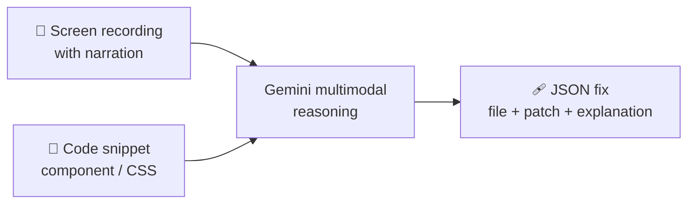

<div align="center">

# ⚡ VibeFix

### Stop writing bug tickets. Show the bug to an AI agent.

Upload a narrated screen recording and the relevant code. VibeFix watches, listens and writes the patch.


[How it works](#-how-it-works) · [Output](#-output) · [Getting started](#-getting-started) · [Structure](#-project-structure)

</div>

---

## 🐛 The problem

Bug reports lose information. "The button is broken on mobile" never captures what the user saw, where they tapped, or how frustrated they were. A screen recording does, so VibeFix uses the recording itself as the bug report.

## 🧠 How it works



| Step | What the model does |
|---|---|
| 👀 **Visual analysis** | Finds the defective UI element in the video at the moment the user points it out |
| 👂 **Audio correlation** | Listens to the narration to understand intent and sentiment |
| 🔍 **Code triangulation** | Locates the lines in the snippet that control that element |
| 🩹 **Solution generation** | Writes the corrected code block |

The model runs under a strict "senior full-stack engineer" system instruction and a typed response schema. Calls retry with backoff on quota and server errors, and you can keep chatting about the fix after the first answer.

## 📦 Output

```json
{
  "bug_summary": "One sentence description of the bug.",
  "user_sentiment": "Frustrated/Confused/Helpful",
  "file_to_edit": "src/components/Footer.js",
  "explanation": "The button has a fixed position that collides with the footer.",
  "code_patch": "Actual code snippet to replace the bad code."
}
```

## 🚀 Getting started

**Prerequisites:** Node.js 18+ and a Gemini API key from [Google AI Studio](https://aistudio.google.com/).

```bash
git clone https://github.com/shacrawi92/VibeFix.git
cd VibeFix
npm install
echo "GEMINI_API_KEY=your_key_here" > .env.local
npm run dev
```

> [!WARNING]
> Never commit your API key. Keep it in `.env.local`, which Vite loads automatically, and make sure `.env*` is listed in `.gitignore`.

## 📁 Project structure

```
├── App.tsx                 # App shell, analysis flow, follow-up chat
├── components/
│   ├── UploadZone.tsx      # Video drag-and-drop
│   ├── CodeInput.tsx       # Code context editor
│   └── AnalysisResult.tsx  # Rendered fix & explanation
├── services/
│   └── geminiService.ts    # @google/genai client, schema, retries
├── types.ts
└── vite.config.ts          # Injects GEMINI_API_KEY at build time
```

## 🛠 Tech stack

| Layer | Technology |
|---|---|
| Frontend | React 19, TypeScript, Vite, Tailwind CSS |
| AI | Google Gemini via `@google/genai` (multimodal video + text, structured output) |

## 📄 License

All rights reserved.

<div align="center">

Built by **[@shacrawi92](https://github.com/shacrawi92)**

</div>
